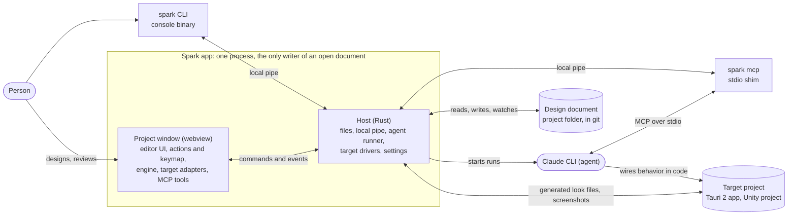
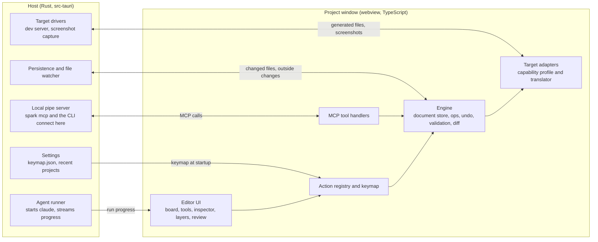
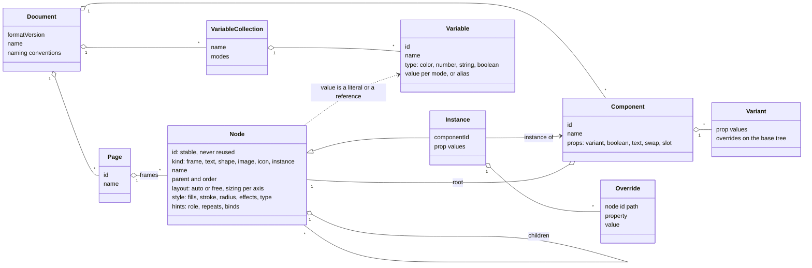
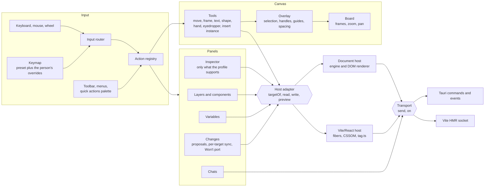
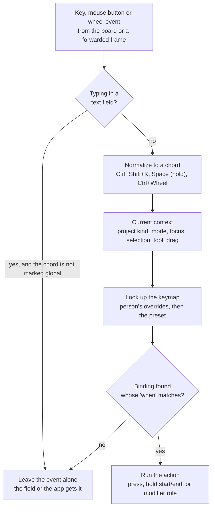
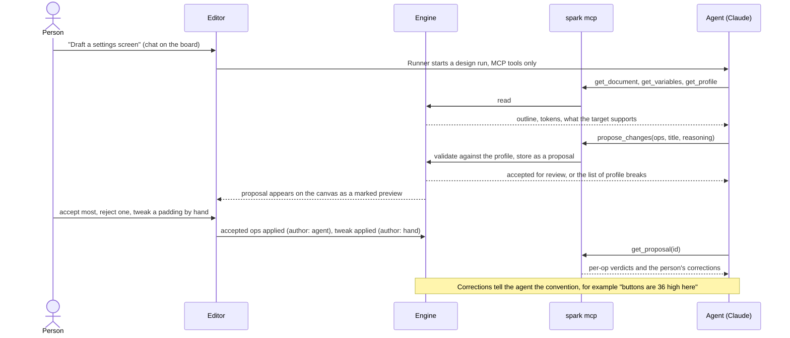
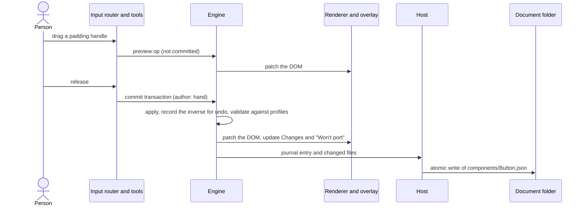
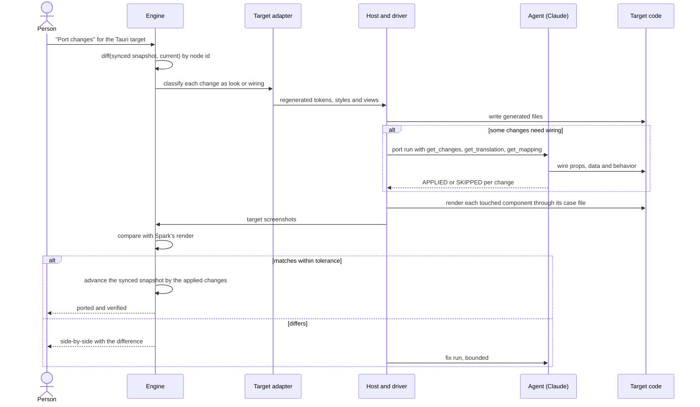
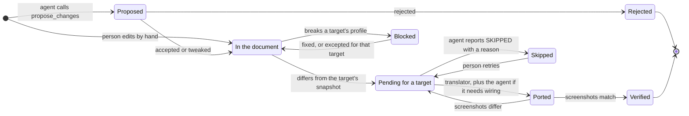
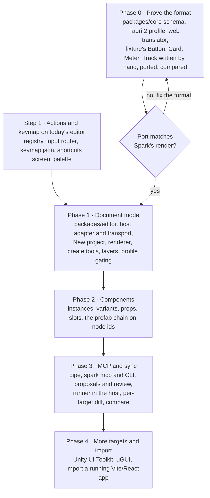

# Standalone Spark: architecture plan

Status: plan for review, nothing here is built yet. Written against `dev` at
`96d7e58`. It builds on the "Spark: standalone design tool assessment" doc and
keeps its phases, and it takes in the findings of the research thread on how
Figma-like tools are built. Where this plan disagrees with that research, it
says so (decision D2).

## 1. What we are building

Today the app's JSX and CSS are the design, and Spark is a lens over a running
Vite/React app. Standalone Spark adds a second project kind where **Spark owns
the design**: a framework-neutral document of frames, nested components with
instances and overrides, and variables. Agents port that document 1:1 to a
target (Tauri 2 first, Unity UI Toolkit and uGUI later), and Spark is the place
where the AI and the person meet on the design.

Three promises drive every choice below:

1. **What you can design ports 1:1.** A capability profile per target limits
   the editor to what that target can render. A deterministic translator
   produces the look. Screenshots check it.
2. **The AI proposes, the person decides.** AI changes arrive as proposals to
   accept, reject or tweak. A value set by hand is never changed silently.
3. **Every change is exact.** Stable ids on every node make "what changed since
   this target last synced" a precise list, not a guess from pixels.

There is no cloud service in this plan. "Backend" means the Rust side of the
desktop app. Everything runs on the person's machine and the design lives in a
folder under git.

## 2. The parts and how they connect



Inside the app, each part of the host serves one part of the window:



| Part | What it is | Where it lives | Built from |
|---|---|---|---|
| Editor UI | The Figma-like surface: board, tools, inspector, layers, variables, chats, review | `packages/editor` (new), mounted by the app window and by the Vite plugin | `shell.ts`, `client.ts`, `fields.ts`, `sidebar.ts`, `variables.ts`, `theme.ts` moved and split |
| Action registry and keymap | Every command as a named action; keys, toolbar, menus and the quick actions palette all dispatch through it | `packages/editor/actions` | New; replaces key checks scattered over `client.ts`, `shell.ts`, `frame.ts`, `fields.ts`, `mode.ts` |
| Engine | The document in memory: store, ops, undo, instance resolution, profile validation, structural diff | `packages/core` (new, TypeScript, no DOM) | The `Change` model and prefab chain from `changes.ts`, re-keyed by node id |
| Target adapters | Per target: a capability profile (data), a deterministic translator, the agent's instructions | `packages/targets/*` | New. The web translation is shared with the canvas renderer |
| MCP tool handlers | The tool list agents call; reads, proposals, changes, render, sync | `packages/core/mcp` | New |
| Host | Windows, files, the pipe, child processes, capture, settings | `src-tauri` | `project.rs` grows a document path next to the Vite path |
| Agent runner | Starts `claude -p`, streams progress, parses `APPLIED`/`SKIPPED` | `src-tauri` for documents | `runner.ts`, `prompt.ts`, `chats.ts` as the model; the Vite plugin keeps its Node copy |
| `spark mcp` and CLI | A stdio shim and commands that talk to the running app over the pipe | A small console binary in the Cargo workspace | New |
| Design document | The source of truth: JSON files, one per page and component | A folder the person picks, under git | New format, section 4 |
| Vite/React mode | Today's product, unchanged for the person | `packages/vite-plugin` | Becomes one of two hosts behind the same editor |

## 3. Decisions this plan rests on

Each of these is a recommendation with the alternative it rules out. They are
the parts of the plan most worth pushing back on.

**D1. One process owns an open document.** The Spark app is the only writer.
The editor, `spark mcp` and the CLI are all clients of it. If the app is not
running, `spark mcp` starts it without a window. This is what lets an agent's
proposal appear live on the canvas, keeps one undo history, and avoids two
programs writing the same JSON files. The alternative, an MCP server that
edits files on its own, needs merging and file watching to be correct, and the
editor would learn about AI changes late.

**D2. The document logic is written once, in TypeScript, and runs in the
webview.** `packages/core` has no DOM or Node dependencies, so the same code
runs in the project window (the engine), in Node (tests, CI, an npm-run CLI)
and later anywhere else. The Rust host stays thin: files, pipes, processes,
capture. It treats document files as opaque JSON, so there is no second copy
of the schema to drift.

The research thread recommends the opposite: the model owned by a Rust core,
the schema defined once in Rust with generated TypeScript types, and the UI
keeping a mirror that applies ops optimistically. That gives a CLI and MCP
server that work with no webview at all. This plan still prefers TypeScript
for one reason: the canvas has to resolve instances and turn nodes into CSS on
every pointer move, and the exporter has to do exactly the same thing (D3).
With a Rust core that logic either exists twice (Rust for export, TypeScript
for the canvas), which is the drift that breaks 1:1, or it crosses into WASM
or IPC on every drag. With a TypeScript core it exists once. The cost is that
headless work needs a hidden webview or Node, which is the first spike in
section 14. This is the biggest fork in the plan and it has to be settled
before Phase 0 writes the translator (open question 1).

**D3. The canvas draws with the web translator.** The function that turns a
resolved component into HTML and CSS for the Tauri target is the same one the
board uses to draw frames. For web targets, 1:1 then holds by construction:
what is on the canvas is the exported code's output. For Unity it gives one
reference render to compare screenshots against.

**D4. "What changed" is a structural diff of two snapshots, not a replayed
log.** Each target stores the document as it was when last synced. Changes for
that target are `diff(synced, current)`, keyed by node id. Ten scrubs of one
padding are one change, an undone edit is no change, and a `git checkout`
cannot corrupt it. A journal of ops still exists, with a sequence number and
an author on every entry. It serves undo, history and attribution, and it is
what answers "what did the person change by hand after accepting my
proposal". Porting does not depend on replaying it.

**D5. The translator owns the look; the agent owns the wiring.** Tokens,
styles and structure are generated files that Spark rewrites deterministically.
The agent connects them to data and behavior and fits them into the codebase.
A change that only touches the look ports with no agent run at all.

**D6. Every command is an action.** Nothing listens for a key directly. This
is what makes remapping possible, and it also gives the toolbar, menus, the
palette and tooltips one source for names and shortcuts.

## 4. Document store

### Model



Layout follows Figma's auto layout (a flexbox subset) plus free placement with
constraints. Components keep today's prefab chain exactly: base, variant,
instance; edits flow only down; "apply upstream" moves an override up a step;
variables are global. Interaction states (hover, pressed, disabled, focus) are
variants. The format describes how UI looks and is structured, not what it
does.

### On disk

```
my-app.spark/
  spark.json              manifest: format version, name, targets, naming conventions
  variables.json          W3C design tokens (DTCG) with modes
  components/Button.json  one file per component: tree, props, variants
  pages/Main.json         one file per page: frames with board positions, instances
  assets/                 images, icons, fonts
  provenance.json         which values were set by hand
  targets/tauri/
    target.json           adapter, code folder, options
    mapping.json          component and variable ids to code files and symbols
    synced.json           the document as last ported, with its revision
  .spark/                 local, ignored by git: journal, proposals, chats, selection, render cache
```

One file per component and page keeps git diffs small and lets two agents work
on different components. The folder can sit inside the target's repo (for
example `my-app/design.spark/` with the target's code folder `..`) or stand
alone and point at one or more code folders.

### In memory and on save

- The engine holds a normalized store, as Figma does: a map of node id to
  properties. A node's parent and its position among its siblings are one
  property, so a move or reorder is a single atomic change to one node and
  shows up in a diff as exactly that. Files on disk stay nested trees, which
  read better in git and for agents.
- Every edit is an **op** with an exact inverse: `node.insert`, `node.remove`,
  `node.move`, `node.set` (one property), `text.set`, `component.create`,
  `component.setProp`, `variant.set`, `override.set`, `override.clear`,
  `override.applyUpstream`, `variable.create`, `variable.set`,
  `variable.rename`, `variable.remove`. A drag is many previews and one
  named transaction committed when the gesture ends.
- Undo is per author. The person's undo never unwinds an AI proposal they did
  not make, and an accepted proposal is one undo group.
- Each transaction is validated against the project's profiles (section 7),
  appended to the journal with its author (`hand` or `agent`) and a revision,
  and saved: the host writes only the files that changed, atomically.
- The host watches the folder. A change from outside (git pull, a hand-edited
  file) is diffed by node id against what is in memory and shown as a
  changeset to review, the same way an AI proposal is.
- The format is versioned from day one and only ever gains fields, like
  `changes.json` today, because updates reach every install. Files are
  written with sorted keys, fields a build does not know are kept on save,
  and migrations only go forward and are recorded in `spark.json`.

## 5. The editor



Two seams make one editor serve both project kinds.

**Host adapter.** The overlay and panels stop asking React and the CSSOM
directly. They ask an adapter: `targetOf(element)`, `read(target)`,
`write(target, property, value, level)`, `preview(...)`. Today's code becomes
the Vite/React host. The document host answers the same calls from the engine.
`client.ts` is 2,607 lines and mixes both, so this split is the main
engineering cost of reuse.

**Transport.** Today the client talks to the plugin's Node side over Vite's
HMR socket (`spark:select`, `spark:changes`, `spark:run` and so on). The
editor will send the same messages through a two-method transport, backed by
the HMR socket in Vite projects and by Tauri commands and events in document
projects.

What each area needs:

- **Board** (`shell.ts`): carries over nearly as is. A frame stays an iframe,
  as today and as DOM-based editors generally do, but in a document project
  it is a same-origin page the renderer draws into rather than the app's dev
  server. The frame keeps the design's CSS, fonts and variables apart from
  Spark's own, and the input router listens on it directly.
- **Renderer**: new. Resolves instances, overrides and variables, then draws
  with the shared web translation (D3), tagging each element with its node
  id. It patches the DOM per op, so scrubbing a value stays smooth.
- **Tools**: new. Today only existing elements can be edited. Document
  projects add creating frames, text, shapes, images and instances, plus
  drag to move and reparent. Each tool is a small state machine driven by
  actions and pointer events.
- **Inspector** (`fields.ts`): the widgets carry over as they are. The
  profile decides which controls show and clamps values, and says why.
- **Layers and components**: new left-sidebar tabs next to Chats and Changes.
- **Changes**: grows from "pending edits for Claude" into three lists: AI
  proposals to review, what each target has not ported yet, and "Won't port".
- **View mode** exists only in Vite projects, where there is a running app to
  use. A document has no behavior to click through.

## 6. Controls: actions and key mappings

Every command is an **action**. Keys, mouse buttons, the toolbar, menus and
the palette are just ways to trigger one.



**Action.** `{ id, title, category, kind, when, run }`, for example
`tool.eyedropper`, `view.zoomToFit`, `selection.parent`, `component.create`,
`ai.ask`. Registered once; the registry is also the list the palette searches
and the source of the shortcut shown in every tooltip and menu.

**Three kinds of binding**, because a design tool is not only key presses:

| Kind | Meaning | Examples today |
|---|---|---|
| Press | Run once | Undo, delete, switch tool |
| Hold | Active while held, then back | Space to pan, Alt to show spacing |
| Modifier role | Changes a drag in progress | Shift keeps proportions, Alt scrubs slowly, Ctrl snaps a frame to the grid, Shift steps by 10 |

Wheel and mouse chords (Ctrl+wheel zoom, Shift+wheel sideways pan, middle
drag pan) are bindings too, so they can be remapped like the rest.

**Context.** A binding can carry a `when` such as `kind == document`,
`mode == edit`, `selection.kind == instance` or `review`. The editor keeps a
small set of context keys up to date. This is how Tab can mean "next sibling"
in a document project, as in Figma, and "switch View/Edit" in a Vite project,
as today. The existing rule stays: while typing in a field, keys belong to the
field unless a binding is marked global.

**Keymap layers.** A shipped preset, then the person's overrides on top.
Overrides are stored as a diff (add this binding, remove that one), so new
default shortcuts in an update still arrive. The file is per user, not per
project: the host reads and writes `keymap.json` in the app's config folder
and hands it to the editor at startup in both project kinds. Presets: "Figma"
(default) and "Spark classic" (today's keys). Import and export are the same
JSON.

```json
{
  "version": 1,
  "preset": "figma",
  "bindings": [
    { "action": "tool.eyedropper", "keys": "C" },
    { "action": "tool.eyedropper", "keys": "I", "remove": true },
    { "action": "view.zoomToFit", "keys": "Ctrl+1" }
  ],
  "modifiers": { "drag.fine": "Ctrl", "drag.snap": "Alt" }
}
```

**Matching keys.** Letters match the character the layout produces, so `I`
is the key labeled I on any keyboard. Digits and punctuation match the
physical key, so `Shift+1` works on layouts where the digit row needs Shift.
Shortcuts are displayed with the labels of the current layout.

**Settings UI.** A "Keyboard shortcuts" screen: actions by category with
search, click a row and press the new keys, a warning when the chord is
already taken in an overlapping context, reset one or all, switch preset,
import and export. The webview's own shortcuts (reload, print, find) are
turned off in project windows so they can't fire instead of Spark's.

**Default preset (Figma-like).** To be checked against the research thread's
findings before it ships.

| Category | Action | Default |
|---|---|---|
| Tools | Move | `V` |
| | Frame | `F` |
| | Rectangle, Ellipse | `R`, `O` |
| | Text | `T` |
| | Hand | `H`, hold `Space` |
| | Eyedropper | `I` |
| | Insert component | `Shift+I` |
| View | Zoom in, out | `Ctrl+=`, `Ctrl+-`, `Ctrl+Wheel` |
| | Zoom to 100% | `Ctrl+0` |
| | Zoom to fit, to selection | `Shift+1`, `Shift+2` |
| | Pan | `Wheel`, `Shift+Wheel`, middle drag |
| | Show or hide the UI | `Ctrl+\` |
| | Quick actions palette | `Ctrl+/`, `Ctrl+P` |
| Selection | Select parent, child | `\`, `Enter` |
| | Next, previous sibling | `Tab`, `Shift+Tab` |
| | Deep select | `Ctrl+Click` |
| | Step out | `Esc` |
| Edit | Undo, redo | `Ctrl+Z`, `Ctrl+Shift+Z`, `Ctrl+Y` |
| | Duplicate, delete | `Ctrl+D`, `Delete`, `Backspace` |
| | Copy, paste properties | `Ctrl+Alt+C`, `Ctrl+Alt+V` |
| | Rename | `Ctrl+R` |
| | Frame selection | `Ctrl+Alt+G` |
| | Add auto layout | `Shift+A` |
| | Nudge, big nudge | arrows, `Shift` + arrows |
| | Bring forward, send backward | `Ctrl+]`, `Ctrl+[` |
| | Show or hide, lock | `Ctrl+Shift+H`, `Ctrl+Shift+L` |
| | Opacity 10% to 100% | `1` to `0` |
| Components | Create component | `Ctrl+Alt+K` |
| | Detach instance | `Ctrl+Alt+B` |
| | Apply override upstream | unbound |
| Spark | Ask Claude about the selection | `Ctrl+K` |
| | Accept, reject the change in review | `Ctrl+Enter`, `Ctrl+Backspace` |
| | Next, previous change | `Alt+]`, `Alt+[` |
| | Port changes to the target | unbound |
| | View or Edit (Vite projects) | `Tab`, `Alt+E` |
| | Open or close Spark's panel | `Alt+S` |
| Drag modifiers | Keep proportions, step by 10 | `Shift` |
| | Fine scrub, show spacing | `Alt` |
| | Snap frame to grid | `Ctrl` |

**Eyedropper**, since it was the example asked for: the action picks a color
from anywhere on the canvas and applies it to the selected node's fill, or to
the color field that has focus. Because the document knows what is under the
pointer, it picks the **variable** when the sampled fill is bound to one, and
the raw color with the fine modifier held. That keeps designs on the token
system instead of filling them with one-off hex values.

This system does not depend on the document work. It can be built on today's
editor first (section 13, step 1).

## 7. Capability profiles and target adapters

A target adapter has four parts:

| Part | What it is | Runs in |
|---|---|---|
| Profile | Data. For every format feature: supported, limited (with the limits) or not, and the one translation rule | Engine |
| Translator | A pure function: resolved document plus mapping in, files out | Engine |
| Driver | Starts the target, writes generated files, renders a component for a screenshot | Host |
| Agent pack | The target's instructions and conventions for Claude | Runner |

The profile gates three things with the same data: which controls the
inspector shows, what the validator puts on the **Won't port** list (node,
feature, target, reason), and what an AI proposal is allowed to contain. A
proposal is validated before the person sees it, so the AI learns about a
break from the tool's reply instead of from a failed port. A project with two
targets designs in the overlap of their profiles, with explicit single-target
exceptions that name a fallback.

What the translator writes for the first target, Tauri 2 with React:

- `tokens.css`: variables as CSS custom properties, one block per mode
  (`[data-theme="dark"]`), with aliases kept as `var()` so the token
  structure survives in code.
- Per component, a style sheet with class names derived from stable ids, and
  a presentational view (structure, slots, props) with a "generated by Spark"
  header. These are regenerated, never hand-edited.
- A case file per component (the existing `*.spark.tsx` idea) that renders
  each variant alone. The driver uses it to take target screenshots.

`mapping.json` records, per component, whether its code is **generated**
(Spark rewrites it) or **adopted** (hand-written code the agent keeps in step,
using the translator's output as the spec). New standalone projects start
fully generated. Adopted is the path for bringing an existing app in later.

Unity UI Toolkit gets the same shape (USS variables, UXML plus USS, a driver
that renders a UIDocument to a texture), then uGUI (prefabs, layout groups,
anchors). Adding a target is a profile, a translator, a driver and a
conformance document that uses every supported feature. The editor does not
change.

## 8. The AI and human loop



Rules:

1. **MCP writes are proposals.** No tool changes the document directly. A
   proposal is a named changeset of ops with its reasoning and the revision it
   was made against.
2. **Review is per op.** The Changes tab lists each proposal; the canvas shows
   it as a preview that can be toggled against the current design. Accept,
   reject or tweak each op, or the whole set.
3. **Hand edits are marked.** A property the person set by hand is recorded in
   `provenance.json`. An op that would change it is flagged in review and is
   never included in a bulk accept without being shown.
4. **Stale proposals are caught.** If the document moved on since the
   proposal's revision, ops whose nodes changed are marked as conflicts
   instead of being applied blind.
5. **Corrections flow back.** What the person changed after accepting is
   returned to the agent, so naming and spacing conventions settle over time
   and get written into `spark.json`.

## 9. MCP server

`spark mcp <folder>` is a stdio shim: it relays MCP messages to the running
app over a per-user local pipe, and starts the app without a window if it is
not running. The tool list and handlers live in `packages/core/mcp`, next to
the model they read. Tool shapes follow the repo rule: fields are only added.

| Tool | Does |
|---|---|
| `get_document` | Outline: pages, frames, components, targets, current revision |
| `get_page`, `get_component`, `get_node` | A tree, resolved or raw with overrides |
| `get_variables` | Variables with modes, in DTCG shape |
| `get_selection` | What the person has selected, with its chain |
| `get_profile(target)` | What the target supports, with limits and rules |
| `get_violations` | The "Won't port" list |
| `propose_changes(ops, title, reasoning)` | Creates a proposal; returns its id and any profile breaks |
| `get_proposal(id)` | Verdict per op and the person's corrections |
| `get_changes(target)` | Structural diff since that target's sync, each change marked look or wiring |
| `get_translation(target, component)` | The translator's files for a component |
| `get_mapping`, `set_mapping` | Ids to code files and symbols for a target |
| `render(node, variant)` | A PNG of Spark's render |
| `compare(target, component)` | Spark's render against the target's, with the pixel difference |
| `mark_synced(target, applied, skipped)` | Advances the target's snapshot by the applied changes; skipped ones stay pending |

## 10. Agent runner

The runner moves the existing pattern (`runner.ts`) into the host for
document projects: one `claude -p` run at a time per project, stream-json
events boiled down to progress lines, chats stored per element, the
`APPLIED <id>` / `SKIPPED <id>: why` protocol. The Vite plugin keeps its own
runner unchanged.

| Run | Working folder | May do |
|---|---|---|
| Design (draft, restructure, rename, suggest variables) | The design project | Spark's MCP tools only; no file edits |
| Ask (chat on a selection) | The design project | Same |
| Port (first port or a diff) | The target's code folder | Edit files there, plus Spark's MCP tools |
| Fix (after a failed compare) | The target's code folder | Same, with the diff image; a bounded number of rounds |

Every run gets an MCP config that points at `spark mcp` for the open project,
so the agent is connected without the person setting anything up.

## 11. CLI

One console binary next to the app, sharing the pipe client with the MCP
shim. It is a separate binary because a Windows GUI executable cannot print
to the terminal that launched it.

| Command | Does |
|---|---|
| `spark <folder>` | Opens a project (exists today) |
| `spark new <folder> --target tauri2` | Creates a design project |
| `spark mcp [<folder>]` | The MCP server on stdio |
| `spark status [--target <id>]` | Unported changes per target, proposals waiting, "Won't port" |
| `spark export --target <id>` | Runs the translator and writes the generated files |
| `spark render <node> -o file.png` | Spark's render of a node |
| `spark check [--target <id>]` | Validates against profiles and runs the screenshot compare |
| `spark port --target <id>` | Runs the port without opening a window |

Because `packages/core` is plain TypeScript, `export` and the profile part of
`check` can also run from Node in CI without the app installed.

## 12. Data flow: edit, diff, port

### A hand edit



### Port to a target



A change that only touches the look (a color, a padding, a variable) takes the
top path only: regenerate, write, compare, done, with no agent run and no
tokens spent. The agent is involved when the diff changes a component's
interface: a new prop or slot, a new component, a removed node that code
refers to, or anything in adopted code.

### One change, start to finish



"Pending" and later states are tracked per target, so a change can be verified
in the Tauri app and still pending for Unity.

## 13. What changes in the repo, in order

```
packages/
  core/            document schema, store, ops, resolve, diff, validation, MCP handlers
  targets/
    web/           HTML and CSS translation shared by the canvas and web targets
    tauri2-react/  profile, translator, case files, agent pack
    unity-uitk/    later
    unity-ugui/    later
  editor/          board, overlay, tools, inspector, sidebars, actions and keymap
  vite-plugin/     the Vite/React host: tag.ts, css.ts, React adapter, Node side
src/               launcher, settings, and the document project window that mounts the editor
src-tauri/         host: project kinds, persistence, watcher, pipe, runner, drivers, capture
crates/spark-cli/  console binary: CLI and the MCP stdio shim
```

The steps keep the assessment's phases and say where each part of this plan
lands. `dev` stays shippable throughout: the Vite mode is only refactored
behind the two seams, never broken.



Step 1 and Phase 0 are independent and can run side by side. Step 1 is worth
doing first on its own: it delivers remappable controls in the current dev
builds, and it means the Phase 1 split of `client.ts` moves handlers that are
already actions.

## 14. Risks and the spikes that settle them

| Risk | Why it matters | Settle it with |
|---|---|---|
| Headless engine in a hidden webview | D1 and D2 need the engine and `render` to work with no window shown; hidden WebView2 pages can be throttled or skip painting | A spike before Phase 3: start hidden, load a document, capture a PNG through the WebView2 screenshot call. Fallback: an off-screen window, or a Node sidecar for headless only |
| Text is the hardest 1:1 | Font metrics, line height and wrapping differ between Chromium and Unity's text engine | Ship fonts in `assets/`; make text wrapping the first thing the Phase 0 comparison checks |
| Splitting `client.ts` | It is the cost of keeping one editor for two project kinds; a half-done split leaves two drifting editors | Do it behind the host adapter with the Vite mode's behavior pinned by the fixture, one area at a time |
| Scope creep into a Figma clone | Figma's value is a decade of editor polish | No pen tool, boolean ops, prototyping, comments or multiplayer. Spark wins on the exact diff and the port loop |
| Generated code people want to edit | A hand edit to a generated view is lost on the next port | The "generated" header, the adopted mode for code that must be hand-owned, and a check that refuses to overwrite a generated file that was modified |
| Format compatibility | Updates reach every install | Version from day one, fields only added, migrations on load |
| Key conflicts with the system and webview | Some chords never reach the page | Webview shortcuts off in project windows; the shortcuts screen lists chords Windows reserves |

## 15. Open questions

1. **TypeScript core or Rust core (D2).** The one decision needed before
   Phase 0. This plan recommends TypeScript; the research thread recommends
   Rust with generated types. If headless use without any webview matters
   more to you than a single canvas-and-export code path, choose Rust and
   accept a WASM build of the translator for the canvas.
2. **Vite mode's future.** Stay a first-class way to edit an app, or become
   mainly an importer into documents once Phase 4 lands? It does not change
   steps before Phase 4.
3. **Where the design folder lives by default.** Inside the target's repo
   (one repo, design and code move together) or its own repo (one design, many
   targets). The format supports both; this is only the default "New project"
   offers.
4. **Generated React views.** This plan has Spark own a presentational view
   per component that the agent wraps. If you would rather have only tokens
   and CSS generated, with the agent writing all JSX, the 1:1 guarantee for
   structure gets weaker but the code looks more hand-written.
